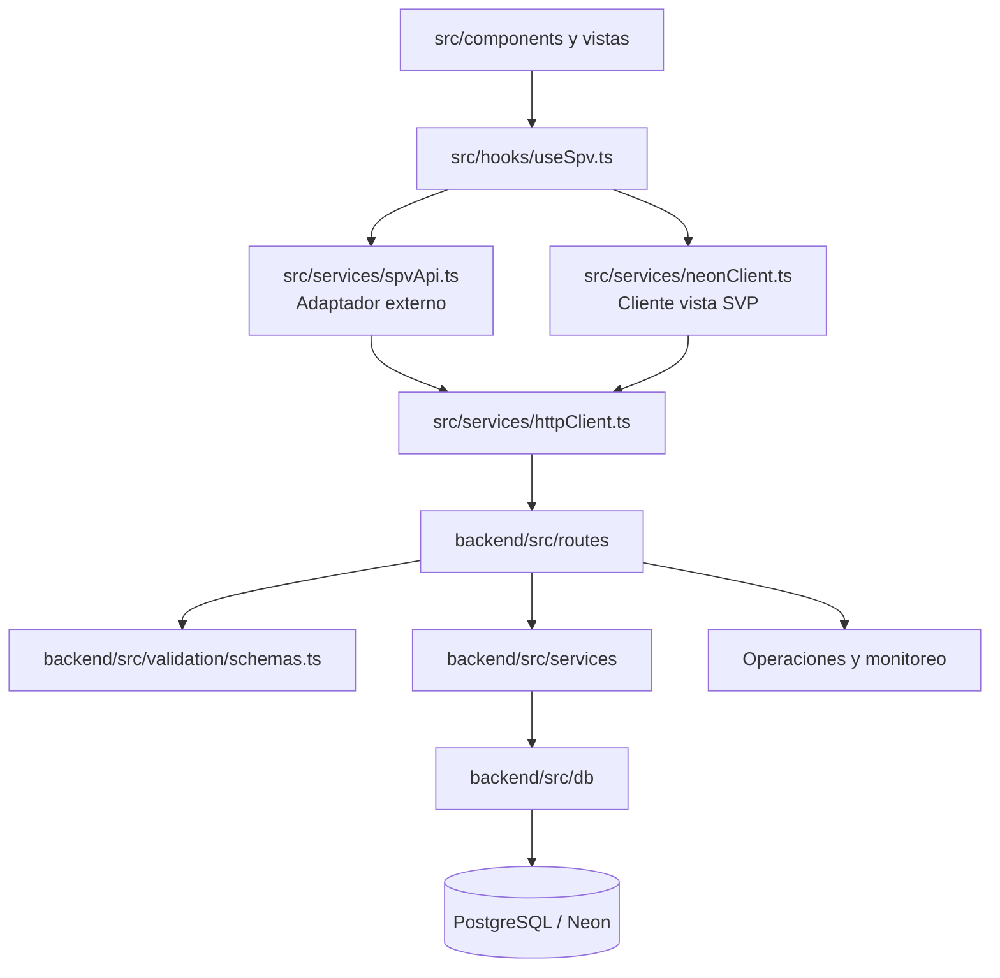
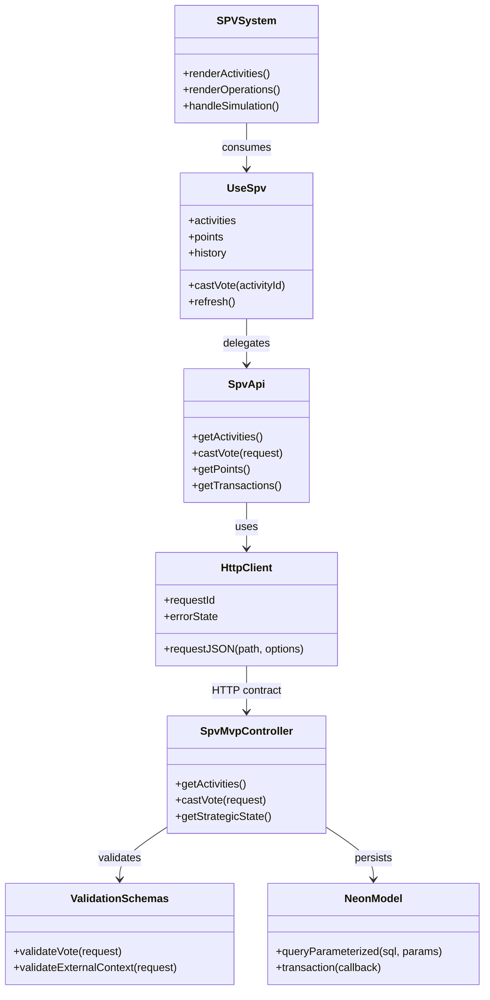
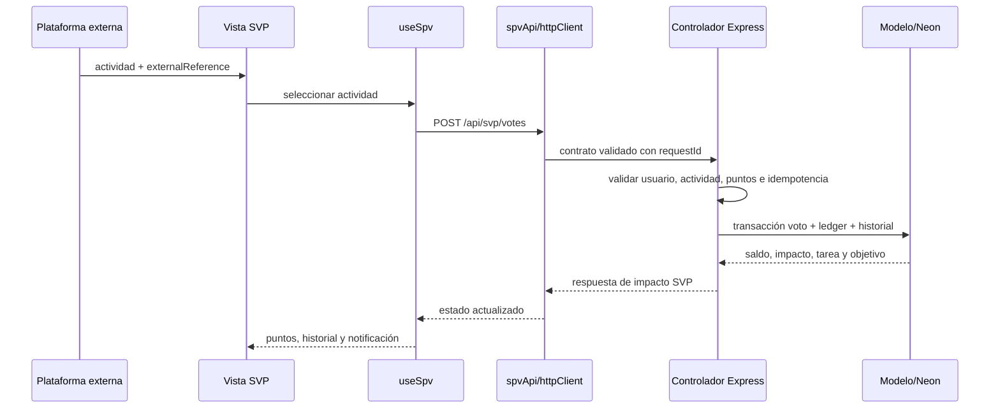
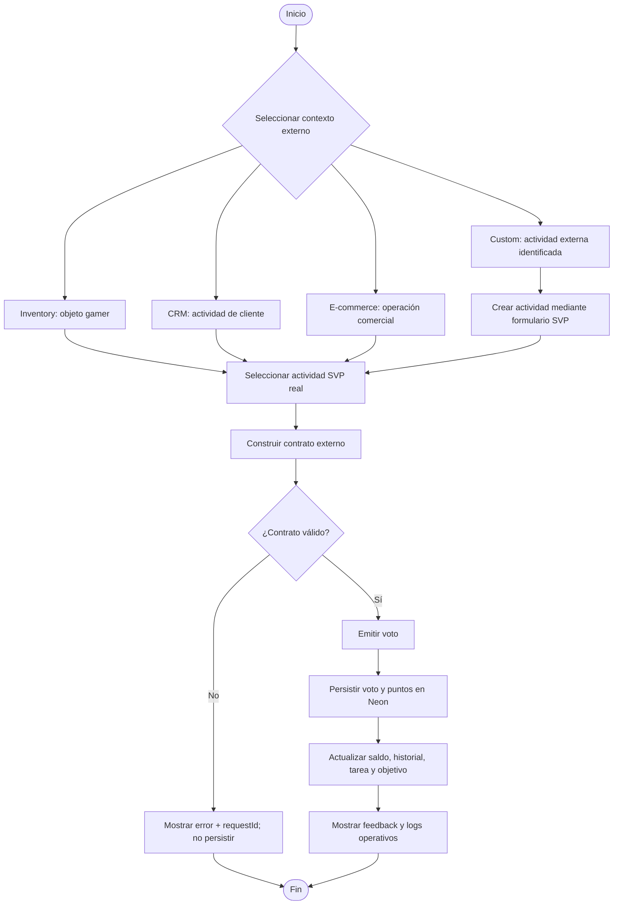

# Diagramas canónicos del sistema SVP

> Estos diagramas describen la implementación actual. Deben actualizarse junto con cambios de rutas, contratos, módulos o persistencia.

## 1. Diagrama estructural



## 2. Diagrama de clases y responsabilidades



## 3. Flujo de código: actividad externa a valor SVP



## 4. Diagrama de actividad: simulación y validación



## Reglas de lectura

- `spvApi.ts` es el adaptador de integración para plataformas externas; no es un script descartable.
- `neonClient.ts` sirve al flujo de vista SVP y no reemplaza automáticamente el contrato externo.
- Inventory, CRM, E-commerce y Custom son contextos de origen; no son mercados ni dinero por sí mismos.
- Los puntos son valor SVP acumulado. Su cotización, comercialización o uso sobre objetos de inventario requiere reglas e integración externa explícitas.
- Una respuesta válida debe conservar trazabilidad: `externalDomain`, `externalReference`, `operationId`, `valueUnit`, voto, ledger e impacto.
- Todo error de contrato debe detener la persistencia y mostrar un estado observable; nunca debe convertirse silenciosamente en datos de demostración.

## Relación con el plan original

La implementación sigue el flujo MVC documentado:

```text
Vista → Hook → Adaptador/cliente → Controlador → Validación → Servicio/modelo → Neon
```

La arquitectura usa módulos y funciones TypeScript, no una jerarquía clásica de clases. El diagrama de clases representa responsabilidades y contratos, no afirma que cada caja sea una clase concreta en el runtime.
